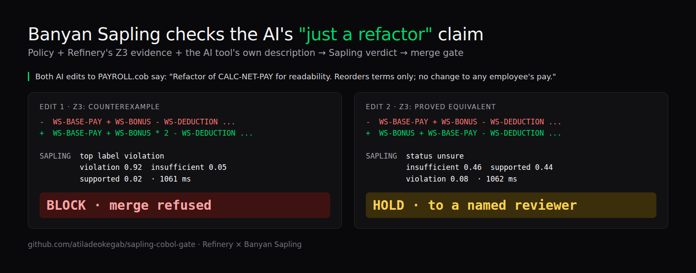

# Sapling COBOL change gate

**An AI tool says its COBOL edit is "just a refactor". Banyan Sapling checks that claim against the bank's change policy and a formal proof, and the gate blocks the merge when the claim is false.**



Banks are letting AI assistants edit decades-old COBOL that moves money. The AI writes a confident change description ("readability refactor, no change to pay") and a tired reviewer approves it. This gate makes the description itself something that gets verified.

## How it works

1. **[Refinery](https://refinery.guru)** audits the change: it diffs the original against the AI-modified program and runs a Z3 formal check that either proves the two compute identical results for every input, or finds a counterexample.
2. **Banyan Sapling** gets three things:
   - **policy**: the change-control rules ([policy.md](policy.md))
   - **evidence**: what the AI tool said it did, the changed lines, and Refinery's formal result
   - **claim**: "The AI-assisted change complies with the policy."
3. **The gate** acts on Sapling's verdict, deliberately asymmetric:

| Gate | When | Effect |
|---|---|---|
| **BLOCK** | Sapling's top label is `violation` at 0.90 or above | Merge refused |
| **PASS** | Sapling returns a calibrated `supported` | Forwarded to human sign-off |
| **HOLD** | Anything else, including `unsure` | Routed to a named reviewer, with Sapling's lean shown |

A false block costs a human five minutes. A false pass costs a payroll run. So Sapling's strong `violation` acts on its own, while a pass needs its calibrated verdict.

Sapling does the judging here. Refinery only supplies facts. Whether an AI's own description of its change breaks policy is the question nobody was checking.

## The demo: one payroll program, two AI edits

`PAYROLL.cob` computes net pay. Two AI edits both describe themselves as *"Refactor of CALC-NET-PAY for readability. Reorders terms only; no change to any employee's pay."*

**Edit 1: the hidden bug** ([cobol/PAYROLL_ai_bug.cob](cobol/PAYROLL_ai_bug.cob)). COBOL `*` binds before `+`, so every bonus is paid twice.

```diff
-               WS-BASE-PAY + WS-BONUS - WS-DEDUCTION - WS-TAX-AMOUNT.
+               WS-BASE-PAY + WS-BONUS * 2 - WS-DEDUCTION - WS-TAX-AMOUNT.
```

```
SAPLING   status unsure, top label violation | violation 0.92  insufficient_information 0.05  supported 0.02  inconsistent_context 0.01 | 1061 ms
GATE      BLOCK: Sapling finds a policy violation (0.92): merge refused
```

**Edit 2: a genuine refactor** ([cobol/PAYROLL_ai_refactor.cob](cobol/PAYROLL_ai_refactor.cob)). Z3 proves it equivalent.

```diff
-               WS-BASE-PAY + WS-BONUS - WS-DEDUCTION - WS-TAX-AMOUNT.
+               WS-BONUS + WS-BASE-PAY - WS-DEDUCTION - WS-TAX-AMOUNT.
```

```
SAPLING   status unsure, top label insufficient_information | insufficient_information 0.46  supported 0.44  violation 0.08  inconsistent_context 0.02 | 1062 ms
GATE      HOLD: no calibrated verdict (leans insufficient_information 0.46): route to a named reviewer
```

Full transcripts: [demo/bug.txt](demo/bug.txt), [demo/refactor.txt](demo/refactor.txt).

## Run it

No keys needed; Sapling's preview endpoint is open. Python 3.10+, standard library only.

```bash
uv run gate.py evidence/bug.json "Refactor of CALC-NET-PAY for readability. Reorders terms only; no change to any employee's pay."
# exit 1 = BLOCK, 0 = PASS, 2 = HOLD, so it drops straight into CI
```

`evidence/*.json` were produced by Refinery's engine with [export_evidence.py](export_evidence.py). Refinery itself is not in this repo.

## Honest limits

- Sapling is a research preview. Calibrated single-label answers are rare (both demo cases are `unsure`), so the gate reads the raw label for BLOCK only.
- The equivalent refactor lands on HOLD, not PASS. That is the safe failure: a human looks.
- Policy and evidence wording was tuned on these two cases. Labels/scores only; Sapling gives no explanation.
