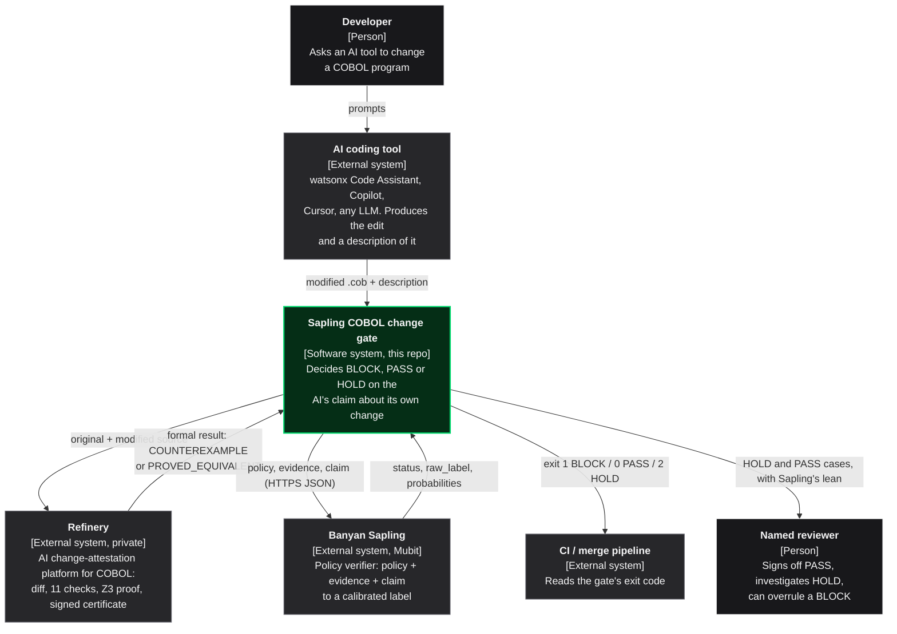
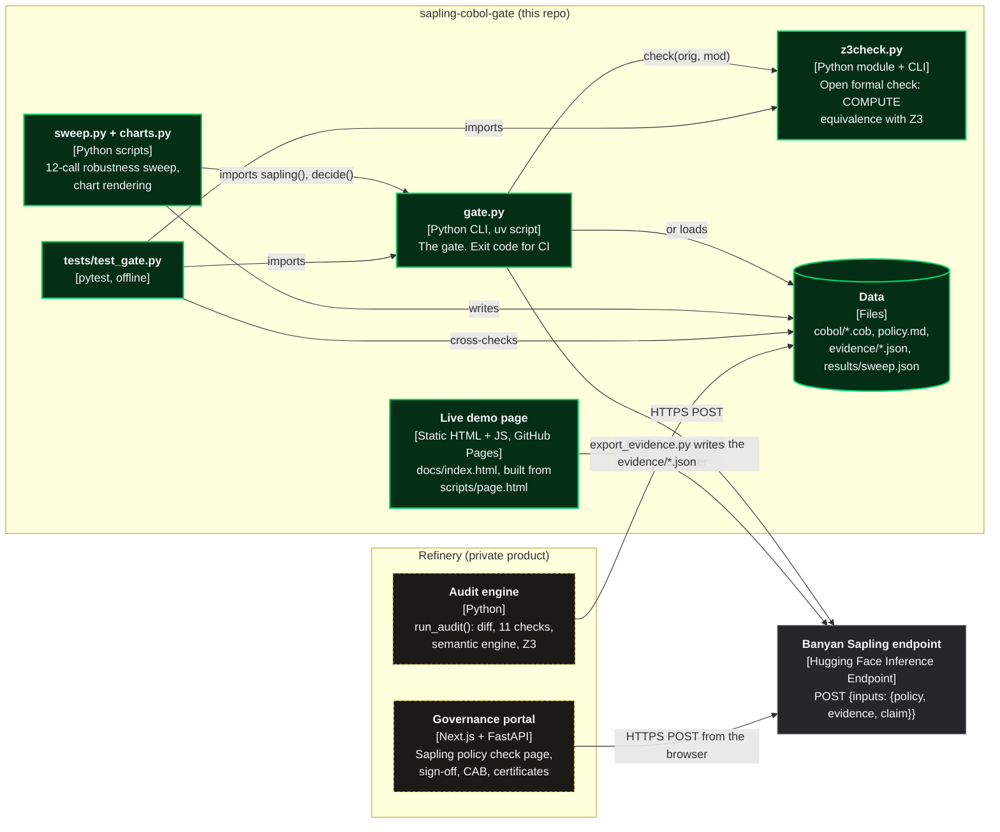
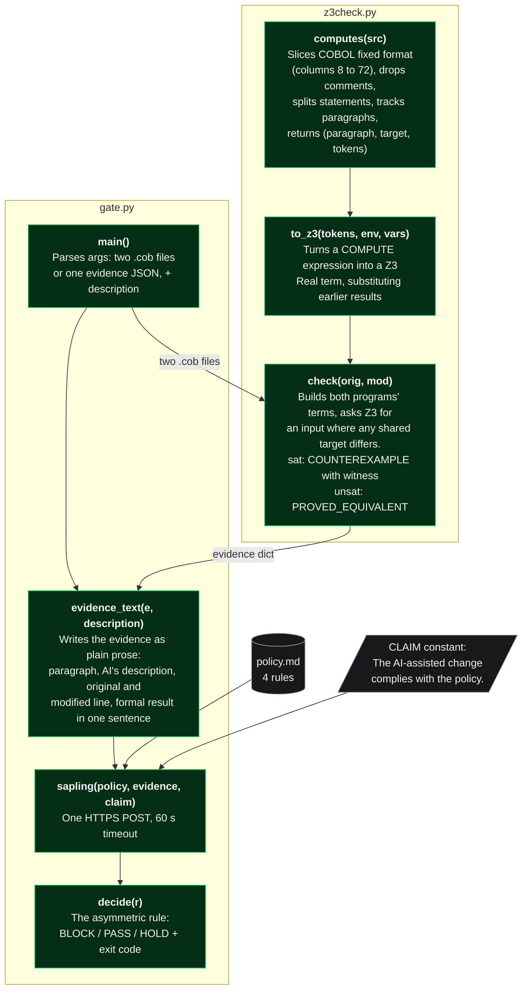
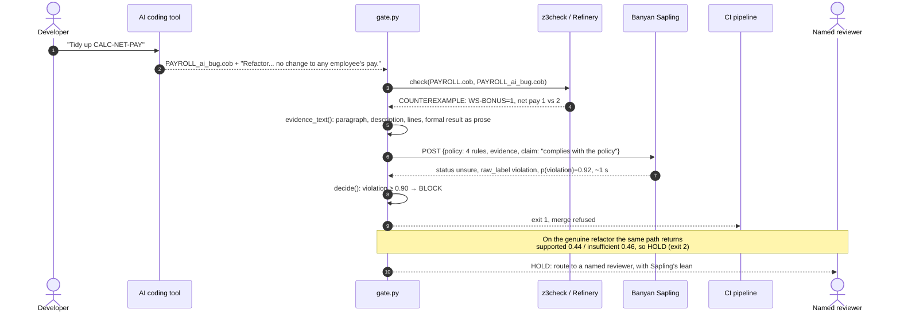
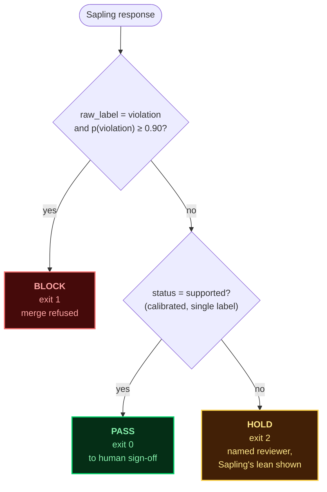
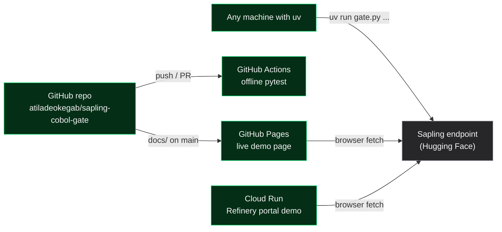

# Architecture

This page describes the system with the [C4 model](https://c4model.com): **context** (who and what
is involved), **containers** (the runnable pieces), **components** (what is inside the gate), and
then the **runtime sequence** of one check and the **gate decision** itself. Every diagram is
Mermaid source, so a human sees a picture on GitHub and an agent can read the text.

Colour key used throughout: green = built in this repo, grey = external system, dark = person.

---

## Level 1: System context

Who uses the gate, and which outside systems it talks to.

**The one idea:** Refinery establishes the *facts* of a change (what the code really does now).
Sapling judges the *claim* (does the AI's description, set against those facts, comply with
the policy). The gate turns Sapling's judgement into an action a pipeline can enforce.

---

## Level 2: Containers

The runnable and deployable pieces. Everything green is in this repository.

| Container | Where | Notes |
|---|---|---|
| `gate.py` | [gate.py](../gate.py) | Standard library plus `z3-solver`. Takes two `.cob` files or one evidence JSON, plus the AI's description |
| `z3check.py` | [z3check.py](../z3check.py) | Small, open re-implementation of the one Refinery check this demo needs. A test pins that it agrees with Refinery's saved evidence |
| Live demo page | [scripts/page.html](../scripts/page.html), published at [docs/index.html](https://atiladeokegab.github.io/sapling-cobol-gate/) | Same evidence wording and gate rule as `gate.py`, in JavaScript; calls Sapling directly from the browser |
| Sweep | [scripts/sweep.py](../scripts/sweep.py), [scripts/charts.py](../scripts/charts.py) | Six AI descriptions × two edits = 12 live calls; results in [results/sweep.json](../results/sweep.json) |
| Refinery engine | private | Produced [evidence/bug.json](../evidence/bug.json) and [evidence/refactor.json](../evidence/refactor.json) via [export_evidence.py](../export_evidence.py) |
| Refinery portal | private, demo deployed on Cloud Run | The same check as a page inside Refinery's governance UI, so a reviewer runs it where they already sign changes off |
| Sapling | Mubit / Banyan, Hugging Face endpoint | No key for the preview. Returns `status`, `raw_label`, `probabilities`, `timing_ms`, `model`, `release_stage`, `weights_sha256` |

---

## Level 3: Components inside the gate

What `gate.py` and `z3check.py` are made of, function by function.

Design notes on the components:

- **Evidence is prose, not engine output.** Sapling is a natural-language verifier. Early runs
  that passed raw JSON from Refinery came back `unsure` for everything; one plain sentence per
  fact (what changed, what the AI said, what Z3 found) gave Sapling something to rule on. The
  `FORMAL` table in `gate.py` holds those sentences.
- **The claim is fixed, the description varies.** We do not ask Sapling "is the AI telling the
  truth?". We ask it to rule on *"The AI-assisted change complies with the policy"*, and put the
  AI's description inside the evidence. The policy's rules then connect the description
  ("refactor") to the formal result ("counterexample") for Sapling to reason over.
- **The rule is in code, the judgement is not.** `decide()` only thresholds Sapling's output. No
  string matching on the description, no hand-written logic comparing the claim to the diff.
  Remove Sapling and the gate cannot tell a lie from a refactor.

---

## Runtime: one check, end to end

---

## The gate decision

Why asymmetric: a wrong BLOCK costs a reviewer a few minutes; a wrong PASS can pay every
employee the wrong amount. So a *strong* violation may act on its own, while a pass needs
Sapling's *calibrated* `supported`, which is rare in the research preview. Everything uncertain
falls to a person. Nothing passes on a guess.

---

## Deployment

No secrets anywhere: Sapling's preview endpoint needs no key and allows cross-origin requests,
so both web front ends call it straight from the browser.
